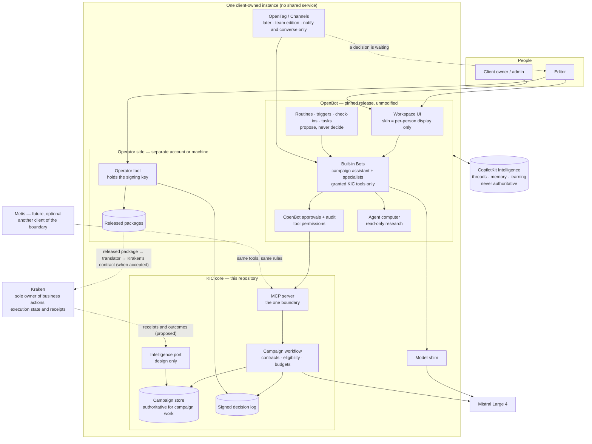

# D4 — Recommended target architecture

Mediation KIC-ARCH-MED-01. A recommendation for owner review. Nothing in it is implemented beyond what D1 lists, and nothing in it has been run inside OpenBot.

## Recommendation in one paragraph

Keep OpenBot, unmodified and pinned to a released version, as the workspace and agent runtime. Keep this repository's MCP server as the one boundary through which every campaign capability is reached, and as the place where editorial decisions, eligibility and budgets are enforced. Use the capabilities OpenBot already has — tasks, routines, triggers, check-ins, hand-off between Bots, approvals, audit — by configuration in the tenant package, not by adding OpenDuet, OpenDots or OpenMuse. Treat skins as a per-person display choice. Add channels later, narrowly, for notification and conversation only. Keep every external business action with Kraken. This is Option A, with the free part of Option B (skins) and the part of Option C that already exists (the boundary), and without a new control plane.

## A point the owner should confirm

The directive calls OpenBot the foundation for "execution". Two different things are called execution:

| | Meaning | Owner |
|---|---|---|
| **Agent work** | Reading, planning, drafting, evaluating, researching, browsing to read | OpenBot, inside the preparation boundary |
| **Business action** | Anything with an external effect of consequence: publishing, scheduling, outreach, spending | Kraken, and only Kraken |

This architecture gives OpenBot the first and never the second. That follows the accepted separation (this side prepares; Kraken executes) and the directive's own requirement that there be one authoritative owner of execution state, permission decisions and external side effects. If the owner intends OpenBot to carry out business actions, that is a change to the accepted separation and needs an explicit decision (D5, P2).

## Diagram

Dotted lines do not exist today.

## Who owns what

One owner per responsibility. Where two components could each claim it, the table says which one wins.

| # | Responsibility | Owner | Others' role | Why |
|---|---|---|---|---|
| 1 | Persistent operational context for campaigns | **KIC campaign store** | Intelligence threads and memory hold conversation only and are never read as fact | Memory cannot override accepted records (standing rule) |
| 2 | Noticing work that could be done | **OpenBot** routines, triggers, check-ins | They call KIC tools to read state and to open a decision request | Native upstream; read-only by design |
| 3 | Planning and breaking work down | **KIC workflow** for campaign structure (brief, narrative, plan, drafts). **OpenBot Bots** for conversational planning around it | — | Campaign structure is typed and checked; conversation is not |
| 4 | Delegation to specialists | **OpenBot** hand-off, with per-Bot grants | KIC decides what each tool may do whoever calls it | Native upstream |
| 5 | Tool and browser use | **OpenBot** computer for reading; **KIC** for campaign tools | No tool with an external business effect is granted to any Bot | Finding 10; accepted separation |
| 6 | Human approval | Three different approvals, three owners: **editorial decisions and release → the operator tool (signed)**; **which tool a Bot may call → OpenBot's gateway**; **whether a business action runs → Kraken** | A Bot may request a decision; it can never record one | Only one of the three is signed and survives a store writer (D1) |
| 7 | Execution feedback and learning | **Kraken** produces receipts; **KIC** stores them as evidence against the programme they belong to (proposed) | Intelligence may propose skills from conversations; a proposal is not an approved skill | Finding 12 |
| 8 | Recovery from interruption | **KIC** for model steps (reserve, call, settle); **OpenBot** for agent turns (re-run, at most twice); **Kraken** for business actions | — | Each recovers what it owns; none claims exactly-once |
| 9 | Communication across channels | **OpenBot through OpenTag**, later | Notify and converse only. No decision, no release, no approval of spend over a channel | Finding 9 |
| 10 | Continuous improvement | **KIC**: versioned prompts, recorded fixtures, eligibility rules, review records | Learned skills are input to a person's review, never applied automatically | Standing rule |
| — | Execution state and external side effects | **Kraken** | — | Accepted separation |
| — | Spend on models | **KIC** ceilings per campaign and per instance for its own calls | OpenBot records the Bots' own model usage; it has no ceiling | D1 |

## Components

| Component | State | Change proposed |
|---|---|---|
| OpenBot | Never run here | Run it unmodified at a pinned release tag. Built-in Bots only. No remote Bots (their own tools bypass OpenBot's approval policy). |
| Skins | UI only | None architecturally. An editor may choose one. |
| Tenant package | One assistant, six skills; validated, never loaded | Add specialist Bots by configuration (below). Add routines by configuration once OpenBot runs. |
| KIC MCP server | Built, tested | No change to its role. It is the boundary for OpenBot today and for any other client later. |
| Operator tool | Built, tested, unreviewed at its last commit | Unchanged authority. Where the editor uses it is OD-9. |
| Model shim | Built, live outside OpenBot | Unchanged. |
| Channels | Not present | Phase 2, through OpenTag, team edition, after OpenTag has been audited. |
| Kraken hand-off | Provisional, non-executable command | Unchanged until Kraken accepts a contract. Then a translator, on this side, from the released package. |
| Feedback | None | A typed feedback event accepted at the boundary (design below). |
| Intelligence port | None | Design only (below). |

### Specialist Bots, by configuration

A proposal for the tenant package. No new runtime, no new store.

| Bot | May call | May not |
|---|---|---|
| Campaign assistant | All KIC tools; hand-off to the others | Record a decision (no such tool exists) |
| Strategist | Brief interpretation, narratives, programme plan, read campaign | Draft, request approval |
| Drafter | Drafts, revision, read campaign | Plan, request approval |
| Checker | Evaluate, compare, read campaign | Generate or revise anything |

Whether separate Bots produce better campaigns than one assistant is **not known**. It is a hypothesis for the proof in D7, not a claim.

## Persistence and learning

| Kind | Where | Authority |
|---|---|---|
| Campaign records, decisions, releases, spend | KIC store, operator side | Authoritative |
| Conversation threads | CopilotKit Intelligence | Convenience |
| Memory about a person | Intelligence, team edition only | Convenience; never read by KIC |
| Learned skills | Proposed by Intelligence | A proposal. Automatic approval off. Nothing learned becomes a KIC skill without a change to the versioned catalogue |
| Execution outcomes | Kraken | Authoritative for what happened; KIC keeps a copy as evidence |

## Governance and approval

- The signed decision log remains the only record that makes something selected, approved or released.
- OpenBot's approval gateway is used as a second line for tool permissions, with "ask before every change" switched on for the instance.
- Automatic approval of learned skills is switched off explicitly; the personal edition's default is on.
- Telemetry opt-out variables are set in the instance.
- OpenBot is pinned to a released tag; an upgrade is a tested change with its own record.

## Channels

Narrow, and later:

1. Outbound: "a decision is waiting for you", with the request id. No content of the decision beyond what the editor needs to find it.
2. Inbound: conversation with the campaign assistant, mapped to a known person by a one-time link code.
3. Never: an editorial decision, a release, or anything that Kraken would treat as authority.
4. Prerequisites: team edition; OpenTag audited (source, licence, deployment, hosted dependencies); the licence tier settled.

## Future interface for Metis

The aim is that another intelligence could do the thinking without this side changing what is allowed. The simplest way to achieve that already exists: **anything that can speak MCP can use the same tools under the same rules.** Metis would be a second client of the boundary, exactly as OpenBot is the first. Nothing of Metis is built, started or required.

Six exchanges, each a typed document at the boundary. All are designs; none is implemented.

| Exchange | Direction | Shape (proposed name) | Already exists as |
|---|---|---|---|
| Task delegation | intelligence → KIC | `kic.task-request/v0`: campaign, skill, inputs, limits, idempotency key | The MCP tool calls |
| Context exchange | KIC → intelligence | `kic.context-bundle/v0`: the brief, the selected narrative, the plan, decisions so far, eligibility rules in force; no credentials, no operator data | `kic_get_campaign` |
| Skill invocation | intelligence → KIC | The versioned skills catalogue: name, version, input and output schema, limits | `kic_list_skills` |
| Evidence and outcome | KIC → intelligence; Kraken → KIC | `kic.evidence-record/v0`: what was produced, by which model and prompt version, at what cost; `kic.execution-receipt/v0`: what Kraken did, with status `confirmed`, `failed` or `unknown` | Generation metadata on every artefact; receipts do not exist |
| Learning feedback | intelligence → KIC | `kic.feedback-event/v0`: subject, observation, evidence reference, source, confidence. Stored as evidence. **Never changes a rule, a prompt or a skill by itself** | Nothing |
| Policy and authority | KIC → intelligence | `kic.authority-statement/v0`: what the caller may do, what needs a person, what is impossible | Tool annotations and refusals |

Three rules keep this forward-compatible without convergence:

1. An intelligence, whichever it is, proposes. Decisions are made by a person through the operator tool; business actions are taken by Kraken.
2. Nothing an intelligence remembers or learns is authoritative here.
3. The boundary is versioned. A provider that needs something new asks for a new version; it does not get a side door.

## Options evaluated

| Criterion | A — OpenBot core, selective augmentation | B — OpenBot unified, with its experiences | C — Kraken-native control plane with adapters |
|---|---|---|---|
| What it means in practice, given D2 | OpenBot unmodified; its native capabilities turned on by configuration; patterns borrowed where useful; channels later | A, plus adopting the OpenDuet and OpenDots skins as "the product", plus selected OpenMuse patterns | A new control layer owned by this programme, with OpenBot, and later others, behind adapters |
| Capability coverage | Everything D3 found valuable | The same. Skins add no capability | The same eventually, after rebuilding orchestration that OpenBot already has |
| Architectural complexity | Lowest: one runtime, one boundary | Same as A; a risk of mistaking a display choice for an architecture | Highest: a second orchestration layer above OpenBot's |
| Implementation effort | Small: configuration and proofs (D6) | A plus nothing real | Large: weeks to months before any gain |
| Operating cost | OpenBot + Intelligence licence + model | Same | Same, plus the new layer |
| Maintenance burden | Track OpenBot releases | Same, plus tracking skin changes that upstream renames at will (one was renamed during this audit) | Maintain adapters against an upstream that changes daily |
| Upstream dependency risk | Present, contained by pinning and by the MCP boundary | Same | Lower in theory; in practice adapters to private interfaces break |
| Security and governance | Decisions signed outside OpenBot; one owner of side effects | Same | Same, if built correctly; more surface to get wrong |
| Upgrade compatibility | Good: OpenBot source untouched | Good | Poor until adapters stabilise |
| Deployment isolation | One instance per client | Same | Same |
| Future Metis compatibility | Good: the MCP boundary is the port | Same | Best on paper; the same port is available in A for nothing |

**Recommendation: Option A.** Take from B only the fact that skins are available and free. Take from C only what already exists: one typed, versioned boundary owned by this programme. Do not build a control plane; revisit that only if a second intelligence provider actually arrives and the boundary proves too narrow.

## What this architecture does not claim

- That OpenBot runs with these parts. It has not been run.
- That specialist Bots improve output.
- That the licence permits a client-owned production instance on the terms assumed.
- That channels through OpenTag work or can be self-hosted.
- That the approval path is free of defects. Five reviews found defects; the last fixes are unreviewed.
