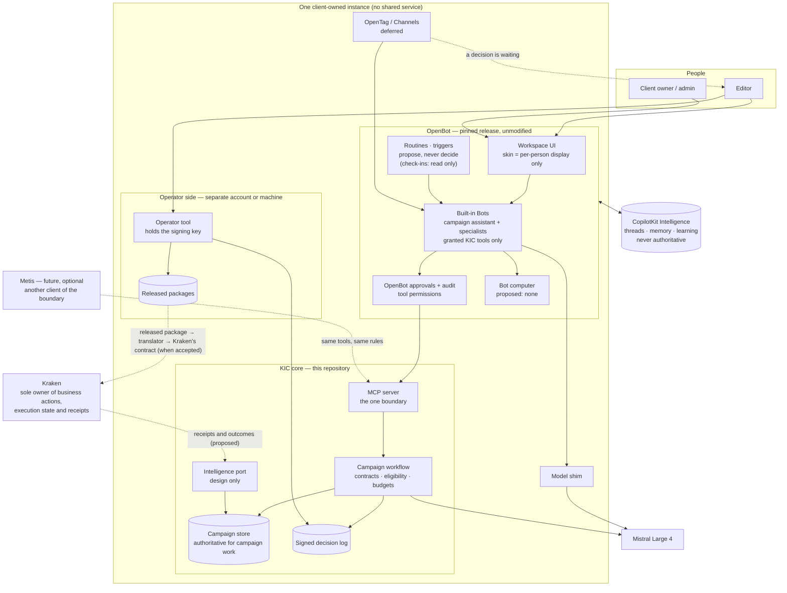

# D4 — Recommended target architecture

Mediation KIC-ARCH-MED-01. **Provisionally accepted by the owner on 2026-11-13**, subject to independent review of the corrected package; that review approved it with corrections, which are in this version. Nothing in it is implemented beyond what D1 lists, and nothing in it has been run inside OpenBot. Statements about OpenBot were read in source and re-checked at release tag `v1.0.2` (A1). Where a line below describes how an instance would be arranged, it is a proposal: no instance exists.

## Recommendation in one paragraph

OpenBot, unmodified and pinned to release `v1.0.2`, is the **preferred workspace candidate, conditional on licensing, runtime verification and confinement** (owner's decision). This repository's MCP server is the authoritative campaign-preparation boundary: every campaign capability is reached through it, and editorial decisions, eligibility and budgets are enforced there. Use what OpenBot already has that fits — routines, hand-off between Bots with per-Bot grants, its approval gateway, its audit — set up in each instance, not by adding OpenDuet, OpenDots or OpenMuse, whose standalone runtimes are excluded. Treat skins as a per-person display choice. Channels are deferred. Kraken is the sole authority for external commercial execution, and each instance would be arranged so that a Bot cannot act outside: in the first place by giving it no computer. This is Option A, with the free part of Option B (skins) and the part of Option C that already exists (the boundary), and without a new control plane. Until OpenBot has passed its runtime, streaming, persistence, tool-execution and confinement tests, the working system is this repository without it, and nothing that has been built is lost either way.

## What "execution" means here (confirmed by the owner)

The directive called OpenBot the foundation for "execution". Two different things are called execution, and the owner has confirmed Kraken as the sole authority for the second:

| | Meaning | Owner |
|---|---|---|
| **Agent work** | Reading, planning, drafting, evaluating, researching, browsing to read | OpenBot, inside the preparation boundary |
| **Business action** | Anything with an external effect of consequence: publishing, scheduling, outreach, spending | Kraken, and only Kraken |

This architecture gives OpenBot the first and never the second. **That does not happen by itself**: OpenBot's Bots can browse, sign in and, after an approval that can be made permanent, post or send (D3 finding 4). An instance must be configured so that they cannot, and the first proof must show it.

Giving OpenBot only the first follows the accepted separation (this side prepares; Kraken executes) and the directive's own requirement that there be one authoritative owner of execution state, permission decisions and external side effects. If the owner intends OpenBot to carry out business actions, that is a change to the accepted separation and needs an explicit decision (D5, P2).

## Diagram

Dotted lines do not exist today.

## Who owns what

One owner per responsibility. Where two components could each claim it, the table says which one wins.

| # | Responsibility | Owner | Others' role | Why |
|---|---|---|---|---|
| 1 | Persistent operational context for campaigns | **KIC campaign store** | Intelligence threads and memory hold conversation only and are never read as fact | Memory cannot override accepted records (standing rule) |
| 2 | Noticing work that could be done | **OpenBot routines and triggers** | A routine runs as the person who created it and may read campaign state and open a decision request through KIC's tools. A check-in is read-only by upstream design: it cannot open a request, and can read KIC only if KIC is connected per person | Native upstream; D3 finding 6 |
| 3 | Planning and breaking work down | **KIC workflow** for campaign structure (brief, narrative, plan, drafts). **OpenBot Bots** for conversational planning around it | — | Campaign structure is typed and checked; conversation is not |
| 4 | Delegation to specialists | **OpenBot** hand-off, with per-Bot grants given by a person in the instance | KIC decides what each tool may do whoever calls it | Native upstream; the tenant package does not grant tools |
| 5 | Tool and browser use | **KIC** for campaign tools. **No Bot computer** in a client instance: campaign preparation needs no browsing | No tool with an external business effect is granted to any Bot. If a computer is ever wanted, the browser, network and password-manager capabilities are off and the posting, sending, sharing and paying kinds are set to "Members do it themselves" — the only setting under which the Bot never does it. All of this is team-edition only and unproven (A1) | D3 findings 4 and 11; accepted separation |
| 6 | Human approval | Three different approvals, three owners: **editorial decisions and release → the operator tool (signed)**; **which tool a Bot may call → OpenBot's gateway**; **whether a business action runs → Kraken** | A Bot may request a decision; it can never record one | Only one of the three is signed and survives a store writer (D1) |
| 7 | Execution feedback and learning | **Kraken** produces receipts; **KIC** stores them as evidence against the programme they belong to (proposed) | Intelligence may propose skills from conversations; a proposal is not an approved skill | D3 finding 13 |
| 8 | Recovery from interruption | **KIC** for model steps (reserve, call, settle); **OpenBot** for agent work (a task turn runs at most twice; a routine dispatch is retried up to the queue's limit); **Kraken** for business actions | — | Each recovers what it owns; none claims exactly-once |
| 9 | Communication across channels | **Deferred by the owner.** If taken up: OpenBot through OpenTag | Notify and converse only; no editorial decision, release or approval of spend over a channel; a separate decision on OpenBot's own tool approvals from a channel card | D3 finding 10; A1 |
| 10 | Continuous improvement | **KIC**: versioned prompts, recorded fixtures, eligibility rules, review records | Learned skills are input to a person's review, never applied automatically | Standing rule |
| — | Execution state and external side effects | **Kraken** | — | Accepted separation |
| — | Spend on models | **KIC** ceilings per campaign and per instance for its own calls. **The model shim** for the Bots' own usage: a cap per request, a limit on requests in flight and a persistent ceiling, in key-injection mode (built and tested at `12a7626`). The figures are the owner's | OpenBot records usage; it has no ceiling | D3 finding 14; OD-6 |

## Components

| Component | State | Change proposed |
|---|---|---|
| OpenBot | Never run here | Run it unmodified at a pinned release tag. Built-in Bots only. No remote Bots (their own tools bypass OpenBot's approval policy). |
| Skins | UI only | None architecturally. An editor may choose one. |
| Tenant package | One assistant, six skills; validated, never loaded | May define further Bots and their skills. It cannot grant tools or define routines: those are done by a person in each instance and belong in the instance runbook. |
| Instance configuration | A proposal document only | New content: which tools each Bot is granted; which kinds of action are closed; no saved logins or connected publishing apps; learned-skill approval off; telemetry off; a ceiling on the Bots' model spend. |
| KIC MCP server | Built, tested | No change to its role. **To be attached to OpenBot `v1.0.2` it needs TLS and a hostname**: that release accepts a custom MCP server only over https at a name, not at a loopback or private address (A1). Unresolved; the first step of the proof. |
| Operator tool | Built, tested; reviewed and approved at `2537386` by agents inside this programme (after this document was written) | Unchanged authority. Where the editor uses it is OD-9. |
| Model shim | Built, live outside OpenBot. Since `12a7626` it limits spend in key-injection mode | The ceiling's figure, set per instance. |
| Channels | Not present | Deferred by the owner. Read-only assessment in A1. |
| Kraken hand-off | Provisional, non-executable command | Unchanged until Kraken accepts a contract. Then a translator, on this side, from the released package. |
| Feedback | None | A typed feedback event accepted at the boundary (design below). |
| Intelligence port | None | Design only (below). |

### Specialist Bots

A proposal. Bots and their skills are defined in the tenant package; the tool grants in the table are given by a person in each instance and recorded. No new runtime, no new store.

| Bot | May call | May not |
|---|---|---|
| Campaign assistant | All KIC tools; hand-off to the others | Record a decision (no such tool exists) |
| Strategist | Brief interpretation, narratives, programme plan, read campaign | Draft, request approval |
| Drafter | Drafts, revision, read campaign | Plan, request approval |
| Checker | Evaluate, compare, read campaign | Generate or revise anything |

Whether separate Bots produce better campaigns than one assistant is **not known**. It is a hypothesis for the proof in D7, not a claim.

## Persistence and learning

| Kind | Where | Authority |
|---|---|---|
| Campaign records, decisions, releases, spend | KIC store, operator side | Authoritative |
| Conversation threads | CopilotKit Intelligence | Convenience |
| Memory about a person | Intelligence, team edition only | Convenience; never read by KIC |
| Learned skills | Proposed by Intelligence | A proposal. Automatic approval off. Nothing learned becomes a KIC skill without a change to the versioned catalogue |
| Execution outcomes | Kraken | Authoritative for what happened; KIC keeps a copy as evidence |

## Governance and approval

Proposals for an instance, except the first, which is how the code works today.

- The signed decision log remains the only record that makes something selected, approved or released.
- OpenBot's approval gateway would be a second line for tool permissions. "Ask before every change" is each person's own switch, so it cannot be relied on as an instance setting: in the team edition an admin sets the consequential kinds of action to "Members do it themselves" and adds team rules; in the personal edition none of that is available, which is a reason not to use that edition for a client.
- The instance would run with no Bot computer (row 5 above).
- The Bots' own model spend would have a ceiling, set in the shim.
- Automatic approval of learned skills is switched off explicitly; the personal edition's default is on.
- Telemetry opt-out variables are set in the instance.
- OpenBot is pinned to a released tag; an upgrade is a tested change with its own record.

## Channels

**Deferred by the owner on 2026-11-13.** The read-only assessment is in A1. If the question is reopened, the shape would be narrow:

1. Outbound: "a decision is waiting for you", with the request id. No content of the decision beyond what the editor needs to find it.
2. Inbound: conversation with the campaign assistant, mapped to a known person by a one-time link code.
3. Never: an editorial decision, a release, or anything that Kraken would treat as authority.
4. To be decided: whether OpenBot's own tool approvals may be answered from a channel card. Upstream supports it and records the answer in its approvals service. Recommended: off, until identity through link codes has been proven.
5. Prerequisites: team edition; OpenTag audited (source, licence, deployment, hosted dependencies); the licence tier settled.

## Future interface for Metis

The aim is that another intelligence could do the thinking without this side changing what is allowed. The simplest way to achieve that already exists: **anything that can speak MCP can use the same tools under the same rules.** Metis would be a second client of the boundary, exactly as OpenBot is the first. Nothing of Metis is built, started or required.

Six exchanges, each a typed document at the boundary. All are designs; none is implemented.

| Exchange | Direction | Shape (proposed name) | Already exists as |
|---|---|---|---|
| Task delegation | intelligence → KIC | `kic.task-request/v0`: campaign, skill, inputs, limits, idempotency key | The MCP tool calls |
| Context exchange | KIC → intelligence | `kic.context-bundle/v0`: the brief, the selected narrative, the plan, decisions so far, eligibility rules in force; no credentials, no operator data | `kic_get_campaign` |
| Skill invocation | intelligence → KIC | The versioned skills catalogue: name, version, input and output schema, limits | `kic_list_skills` |
| Evidence and outcome | KIC → intelligence; Kraken → KIC | `kic.evidence-record/v0`: what was produced, by which model and prompt version, at what cost; `kic.execution-receipt/v0`: what Kraken did, with status `confirmed`, `failed` or `unknown` | Generation metadata on every artefact; receipts do not exist |
| Learning feedback | intelligence → KIC | `kic.feedback-event/v0`: subject, observation, evidence reference, source, confidence. Stored as evidence. **Never changes a rule, a prompt or a skill by itself** | Nothing |
| Policy and authority | KIC → intelligence | `kic.authority-statement/v0`: what the caller may do, what needs a person, what is impossible | Tool annotations and refusals |

Three rules keep this forward-compatible without convergence:

1. An intelligence, whichever it is, proposes. Decisions are made by a person through the operator tool; business actions are taken by Kraken.
2. Nothing an intelligence remembers or learns is authoritative here.
3. The boundary is versioned. A provider that needs something new asks for a new version; it does not get a side door.

## Options evaluated

| Criterion | A — OpenBot core, selective augmentation | B — OpenBot unified, with its experiences | C — Kraken-native control plane with adapters |
|---|---|---|---|
| What it means in practice, given D2 | OpenBot unmodified; the native capabilities that fit, set up in each instance; patterns borrowed where useful; channels later | A, plus adopting the OpenDuet and OpenDots skins as "the product", plus selected OpenMuse patterns | A new control layer owned by this programme, with OpenBot, and later others, behind adapters |
| Capability coverage | What D3 found usable: routines, hand-off with per-Bot grants, approvals, audit | The same. Skins add no capability | The same eventually, after rebuilding orchestration that OpenBot already has |
| Architectural complexity | Lowest: one runtime, one boundary | Same as A; a risk of mistaking a display choice for an architecture | Highest: a second orchestration layer above OpenBot's |
| Implementation effort | Small: configuration and proofs (D6) | A plus nothing real | Large: weeks to months before any gain |
| Operating cost | OpenBot + Intelligence licence + model | Same | Same, plus the new layer |
| Maintenance burden | Track OpenBot releases | Same, plus tracking skin changes that upstream renames at will (one was renamed during this audit) | Maintain adapters against an upstream that changes daily |
| Upstream dependency risk | Present, contained by pinning and by the MCP boundary | Same | Lower in theory; in practice adapters to private interfaces break |
| Security and governance | Decisions signed outside OpenBot; one owner of side effects, provided each instance is confined (D3 finding 4) | Same | Same, if built correctly; more surface to get wrong |
| Upgrade compatibility | Good: OpenBot source untouched | Good | Poor until adapters stabilise |
| Deployment isolation | One instance per client | Same | Same |
| Future Metis compatibility | Good: the MCP boundary is the port | Same | Best on paper; the same port is available in A for nothing |

### The option the directive did not list: no OpenBot

OD-1 records a fallback: the same MCP server and operator tool, used from any MCP client, with no OpenBot.

| | Without OpenBot | Option A |
|---|---|---|
| Needs | Nothing beyond this repository and a model key | OpenBot, Postgres, CopilotKit Intelligence and its licence, an identity provider for the team edition |
| Gives up | A workspace interface, routines, hand-off between Bots, OpenBot's audit, channels | — |
| Prepare-only | By construction: nothing in it can act | By configuration of each instance (D3 finding 4) |
| Conversations kept | Wherever the chosen client keeps them | In CopilotKit Intelligence |
| Upgrade burden | This repository only | OpenBot releases, tested each time |
| State | Built, tested, driven live by an agent | Never run |

For a single-editor pilot this is cheaper and safer, and it is what exists. Option A is recommended for the product a client would recognise as a workspace, and only once the first proof and the licence answer are in. Because the boundary is the same in both, choosing one now does not close the other.

**Recommendation: Option A, conditionally.** Take from B only the fact that skins are available and free. Take from C only what already exists: one typed, versioned boundary owned by this programme. Do not build a control plane; revisit that only if a second intelligence provider actually arrives and the boundary proves too narrow. Until OpenBot has been run and the licence is known, the working system is the fallback.

## What this architecture does not claim

- That OpenBot runs with these parts. It has not been run.
- That an OpenBot instance can be confined to preparation at a released tag. The mechanisms were read on the main branch and not tried.
- That routines, hand-off and grants behave as their source and documents say.
- That specialist Bots improve output.
- That the licence permits a client-owned production instance on the terms assumed.
- That channels through OpenTag work or can be self-hosted.
- That the approval path is free of defects. Eight review rounds found defects; the ninth and tenth, after this document was written, approved `2537386`. No one outside this programme has assessed it (OD-11).
