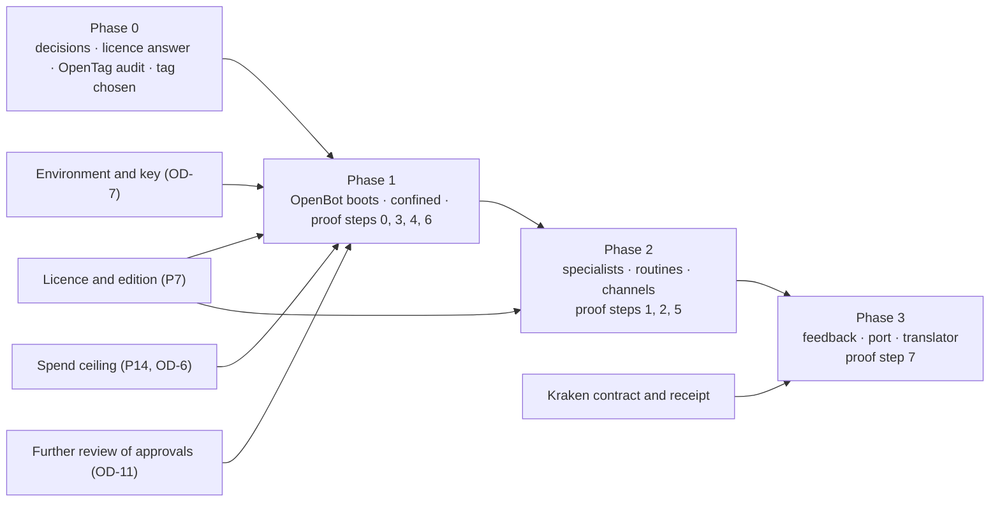

# D6 — Phased integration roadmap

Mediation KIC-ARCH-MED-01. A plan for owner review. No phase starts without the decisions it names. This version includes the corrections from the independent review of the package.

**Effort figures are estimates in working days of engineering.** They are not measurements, they assume the blockers in each phase are already cleared, and they exclude waiting time for owner decisions, licences and reviews. Each is given as a range because nothing here has been run inside OpenBot.

## Phase 0 — Baseline reconciliation and architecture approval

| | |
|---|---|
| Purpose | Agree what exists, what the target is, and what is excluded |
| Work | This mediation (done). Owner review of D1–D7. Written licence answer from CopilotKit, covering the plan a client-owned production instance needs and where conversations are kept. Read-only audit of OpenTag. Choose the OpenBot release tag and re-check, at that tag, each capability the plan relies on (D2 was read on the main branch). |
| Depends on | Nothing |
| Decisions needed | P1 (OD-1), P2 (OD-12), P4 (OD-13), P7 (OD-8, OD-15), P10 (OD-17), P11 (OD-18) |
| Acceptance | The owner records a decision on each of P1, P2, P4 and P7 in the decision register. A written licence answer exists. OpenTag's source, licence and hosted dependencies are documented. A tag is named and the capability re-check is recorded. |
| Risks | The licence answer is unfavourable or slow; the fallback recorded in OD-1 (the same MCP server without OpenBot) remains available and is what works today. OpenTag turns out to need a hosted service. A capability read on main is not in the release. |
| Effort | 2–3 days of engineering. The rest is the owner's time. |

## Phase 1 — Foundation proof

| | |
|---|---|
| Purpose | Prove the foundation: OpenBot, unmodified, running with the three connecting parts, confined to preparation |
| Work | 1. Boot OpenBot at the pinned tag (condition C1). 2. Model through the shim inside OpenBot, streaming and tools (C2). 3. Load the tenant package (the one existing assistant); attach the KIC MCP server; a person grants its tools. 4. One synthetic campaign driven from OpenBot's interface, decisions through the operator tool. 5. Instance settings applied and checked: learned-skill approval off, telemetry off, the confinement settings in P2. 6. D7 steps 0, 3, 4 and 6. |
| Depends on | Phase 0 decisions; OD-7 (an Intelligence project key, and an environment where OpenBot's migrations can create the `vector` extension, which needs Docker or a Postgres image that ships it); P14 / OD-6 (a spend ceiling); OD-11 (a further review of the approval path, before its signed approvals are relied on in a proof) |
| Decisions needed | P1 accepted; P2 confirmed; P14; OD-9 (where the editor confirms) at least provisionally |
| Acceptance | C1 and C2 pass and are recorded with commands and outputs. The synthetic campaign reaches a released, verified package with every decision signed. **An attempt by a Bot to submit a post through its browser, made against a stand-in page inside the instance, is shown to be impossible or refused in the configured instance**, and the configuration that makes it so is recorded. OpenBot's source tree is unmodified (diff against the tag). Spend stayed under the ceiling, the Bots' own included. An independent review of the integration is recorded against the commit. |
| Risks | OpenBot's built-in agent may not tolerate the model through the shim at the pinned release (proven only outside OpenBot). OpenBot's chat surface may present a side-by-side comparison poorly. Confinement may not be achievable in the personal edition, which has no admin. With a managed Intelligence key, conversation threads are stored by the vendor: synthetic data only. The local licence is a macOS preview and is unlikely to fit a Linux environment. Upstream may change between pin and proof. |
| Effort | 5–10 days |

## Phase 2 — Specialists, routines, channels

| | |
|---|---|
| Purpose | Use what OpenBot has that fits, set up in the instance |
| Work | 1. Specialist Bots defined in the tenant package; their tool grants given by a person in the instance and recorded; hand-off between them (D7 steps 1 and 2). 2. Routines, created in the instance, that read campaign state through KIC tools and open decision requests; none that decides. Check-ins are read-only upstream and are not relied on. 3. A measured comparison: one assistant against specialists on the synthetic campaign (quality by the existing evaluation, cost, time). 4. Channels through OpenTag for notification and conversation, if P5 is approved (D7 step 5). 5. The plan as an editor decision, if P12 is approved. |
| Depends on | Phase 1 accepted; team edition and its licence for channels and isolated specialists (P7); OpenTag audit (Phase 0) |
| Decisions needed | P5 (OD-14), P7 edition (OD-15), P12 (OD-19); a gate that authorises changing `tenant-package/` |
| Acceptance | A routine fires, and after a server restart fires again, and produces a decision request and nothing else. A hand-off between two Bots is recorded in OpenBot's audit and each Bot is refused a tool it was not granted. The comparison is recorded with numbers, whichever way it comes out. If channels: a message reaches a linked person; an attempt to make an editorial decision over the channel changes nothing; the choice about tool approvals from a channel card is applied and shown. An independent review is recorded. |
| Risks | Specialists may cost more and improve nothing. A routine firing more than ten minutes late is skipped, not replayed: anything that must not be missed needs its own check. Grants are manual per instance and can drift from what is documented. OpenTag may not be self-hostable. |
| Effort | 8–15 days without channels; channels add 4–8 days and an unknown amount of licence and setup time |

## Phase 3 — Operational learning and the future interface

| | |
|---|---|
| Purpose | Close the loop from what was executed back to what is prepared, without making learning authoritative |
| Work | 1. The feedback event and the evidence record at the boundary (P8, P9; D7 step 7). 2. A receipt from Kraken accepted and stored against its programme, with an explicit unknown outcome. 3. The deferred "performance learning" skill, as analysis shown to an editor. 4. A conformance test for the port: a stand-in second client that uses only the published tools and contracts. 5. A translator from the released package to Kraken's accepted contract. |
| Depends on | Kraken accepting an execution contract and a receipt (Kraken's own gates; KIC-06); Phase 2 accepted |
| Decisions needed | P8, P9 (OD-16); separate authorisation for KIC-06; a gate that authorises new contracts |
| Acceptance | A synthetic receipt, including an unknown outcome, is stored and shown; no rule, prompt or skill changes as a result without a reviewed change. The stand-in client completes a campaign through the boundary and is refused exactly what OpenBot's Bots are refused. The translator produces Kraken's contract from a released package and refuses an unreleased one. Metis is not required for any of it. |
| Risks | Depends on Kraken's timetable. A receipt contract designed before Kraken's execution core exists may need rework. Learning features invite scope growth; the rule that nothing learned is authoritative must hold. |
| Effort | 10–20 days on this side, excluding anything in Kraken |

## Dependencies at a glance

## What stays out of the roadmap

- OpenDuet the fork, OpenDots standalone and OpenMuse as runtimes.
- Any publishing, outreach or spend capability on this side.
- Live JEV.
- A separate control plane.
- Any work in Kraken, Proteus or Metis.
