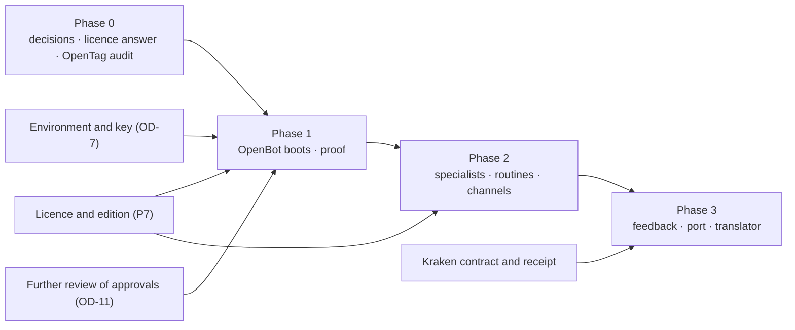

# D6 — Phased integration roadmap

Mediation KIC-ARCH-MED-01. A plan for owner review. No phase starts without the decisions it names.

**Effort figures are estimates in working days of engineering.** They are not measurements, they assume the blockers in each phase are already cleared, and they exclude waiting time for owner decisions, licences and reviews. Each is given as a range because nothing here has been run inside OpenBot.

## Phase 0 — Baseline reconciliation and architecture approval

| | |
|---|---|
| Purpose | Agree what exists, what the target is, and what is excluded |
| Work | This mediation (done). Owner review of D1–D7. Written licence answer from CopilotKit. Read-only audit of OpenTag. |
| Depends on | Nothing |
| Decisions needed | P1 (OD-1), P2, P4, P7 (OD-8), P10, P11 |
| Acceptance | The owner records a decision on each of P1, P2, P4 and P7 in the decision register. A written answer exists on what licence a client-owned production instance needs. OpenTag's source, licence and hosted dependencies are documented. |
| Risks | The licence answer is unfavourable or slow; the fallback recorded in OD-1 (minimal primitives, same MCP server) remains available. OpenTag turns out to need a hosted service. |
| Effort | 1–2 days of engineering (OpenTag audit, licence questions, corrections). The rest is the owner's time. |

## Phase 1 — Low-risk adoption and integration proofs

| | |
|---|---|
| Purpose | Prove the foundation: OpenBot, unmodified, running with the three connecting parts |
| Work | 1. Boot OpenBot at a pinned release (condition C1). 2. Model through the shim inside OpenBot, streaming and tools (C2). 3. Load the tenant package; attach the KIC MCP server by URL. 4. One synthetic campaign driven from OpenBot's interface, decisions through the operator tool. 5. Instance settings from P13 applied and checked (automatic skill approval off, ask-before-change on, telemetry off). 6. The proof in D7, items 1 to 4, 6 and 7. |
| Depends on | Phase 0 decisions; OD-7 (an Intelligence project key or a local evaluation licence; an environment where OpenBot's migrations can create the `vector` extension, which needs Docker or a Postgres image that ships it) |
| Decisions needed | P1 accepted; OD-9 (where the editor confirms) at least provisionally |
| Acceptance | C1 and C2 pass and are recorded with commands and outputs. The synthetic campaign reaches a released, verified package with every decision signed. No tool that publishes, spends or contacts anyone is granted to any Bot (checked from OpenBot's grants). OpenBot's source tree is unmodified (checked by diff against the tag). An independent review of the integration is recorded against the commit. |
| Risks | OpenBot's built-in agent may not tolerate the model through the shim at the pinned release (proven only outside OpenBot). OpenBot's chat surface may present a side-by-side comparison poorly. The personal edition may be too limited to show specialists. Upstream may change between pin and proof. |
| Effort | 4–8 days |

## Phase 2 — Durable collaboration, proactive work, channels

| | |
|---|---|
| Purpose | Use what OpenBot already has, by configuration |
| Work | 1. Specialist Bots in the tenant package with per-Bot grants; hand-off between them. 2. Routines and a check-in that read campaign state through KIC tools and open decision requests; none that decides. 3. A measured comparison: one assistant against specialists on the synthetic campaign (quality by the existing evaluation, cost, time). 4. Channels through OpenTag for notification and conversation, if P5 is approved. 5. The plan as an editor decision, if P12 is approved. |
| Depends on | Phase 1 accepted; team edition and its licence for channels and isolated specialists (P7); OpenTag audit (Phase 0) |
| Decisions needed | P5, P7 (edition), P12 |
| Acceptance | A routine fires, survives a server restart, and produces a decision request and nothing else. A hand-off between two Bots is recorded in OpenBot's audit and each Bot is refused a tool it was not granted. The comparison is recorded with numbers, whichever way it comes out. If channels: a message reaches a linked person; an attempt to decide over the channel is refused. An independent review is recorded. |
| Risks | Specialists may cost more and improve nothing. A late routine firing is skipped, not replayed (upstream behaviour): anything that must not be missed needs its own check. Channel approvals are held in memory upstream: which is why no decision goes over a channel. OpenTag may not be self-hostable. |
| Effort | 8–15 days without channels; channels add 4–8 days and an unknown amount of licence and setup time |

## Phase 3 — Operational learning and the future interface

| | |
|---|---|
| Purpose | Close the loop from what was executed back to what is prepared, without making learning authoritative |
| Work | 1. The feedback event and the evidence record at the boundary (P8, P9). 2. A receipt from Kraken accepted and stored against its programme, with an explicit unknown outcome. 3. The deferred "performance learning" skill, as analysis shown to an editor. 4. A conformance test for the port: a stand-in second client that uses only the published tools and contracts. 5. A translator from the released package to Kraken's accepted contract. |
| Depends on | Kraken accepting an execution contract and a receipt (Kraken's own gates; KIC-06); Phase 2 accepted |
| Decisions needed | P8, P9; separate authorisation for KIC-06 |
| Acceptance | A synthetic receipt, including an unknown outcome, is stored and shown; no rule, prompt or skill changes as a result without a reviewed change. The stand-in client completes a campaign through the boundary and is refused exactly what OpenBot's Bots are refused. The translator produces Kraken's contract from a released package and refuses an unreleased one. Metis is not required for any of it. |
| Risks | Depends on Kraken's timetable. A receipt contract designed before Kraken's execution core exists may need rework. Learning features invite scope growth; the rule that nothing learned is authoritative must hold. |
| Effort | 10–20 days on this side, excluding anything in Kraken |

## Dependencies at a glance

## What stays out of the roadmap

- OpenDuet the fork, OpenDots standalone and OpenMuse as runtimes.
- Any publishing, outreach or spend capability on this side.
- Live JEV.
- A separate control plane.
- Any work in Kraken, Proteus or Metis.
