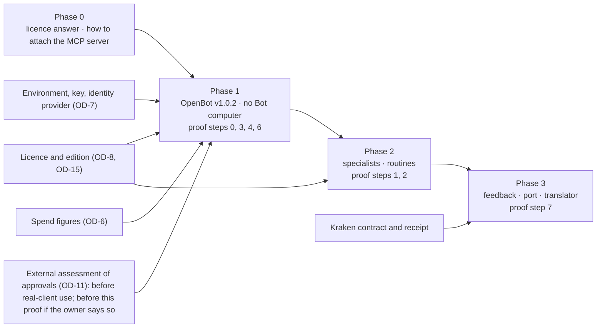

# D6 — Phased integration roadmap

Mediation KIC-ARCH-MED-01. A plan; no phase starts without the decisions it names. This is the third version: it includes the corrections from both independent reviews of the package, the release-tag and OpenTag audits (A1), and the owner's direction of 2026-11-13, which deferred channels and required the selected OpenBot release to pass runtime, model streaming, persistence, tool-execution and confinement tests before any production adoption.

**Effort figures are estimates in working days of engineering.** They are not measurements, they assume the blockers in each phase are already cleared, and they exclude waiting time for owner decisions, licences and reviews. Each is a range because nothing here has been run inside OpenBot.

## Phase 0 — Baseline reconciliation and architecture approval

| | |
|---|---|
| Purpose | Agree what exists, what the target is, and what is excluded |
| Done | The mediation and two independent reviews of it. The owner's provisional acceptance and decisions. The read-only audit of OpenTag. The release tag named (`v1.0.2`) and the capabilities relied on re-checked there (A1). The licence questions drafted, not sent |
| Remaining | The licence answer from CopilotKit, which is the owner's to seek. A decision on how the KIC MCP server is to be attached to `v1.0.2`, which accepts a custom server only over https at a hostname |
| Decisions needed | OD-8 and OD-15 (licence, edition, where conversations are kept); OD-6 (spend figures) |
| Acceptance | A written licence answer exists. An attachment method is chosen that does not modify OpenBot |
| Risks | The licence answer is unfavourable or slow; the fallback recorded in OD-1 (this repository without OpenBot) is what works today. No attachment method works without modifying OpenBot, in which case `v1.0.2` is not usable and a later release must be awaited |
| Effort | 1–2 days of engineering. The rest is the owner's time |

## Phase 1 — Foundation proof

| | |
|---|---|
| Purpose | The tests the owner requires of the selected release: runtime, model streaming, persistence, tool execution and confinement |
| Work | D7 steps 0a to 0d, 3, 4 and 6, on OpenBot `v1.0.2`, team edition, **with no Bot computer**. The one existing assistant; one grant of the KIC tools; one sandbox tool server kept in scratch space; one team rule. One synthetic campaign driven from OpenBot's interface, decisions through the operator tool |
| Depends on | Phase 0; OD-7 (an Intelligence project key; an environment where OpenBot's migrations can create the `vector` extension, which needs Docker or a Postgres image that ships it); an identity provider, which the team edition needs; OD-6; OD-11 (when this was written: a further review of the approval path, before its signed approvals are relied on in a proof. Since then agent reviews have approved `2537386`, and the owner has restated OD-11 as an external assessment required before real-client use; whether it must also precede this synthetic proof is the owner's to say) |
| Decisions needed | Authorisation of Phase 1, which covers the grant, the sandbox tool and the team rule named in D7 and nothing in `tenant-package/` or `src/`; OD-9 (where the editor confirms) at least provisionally |
| Acceptance | Each of D7's steps 0a to 0d, 3, 4 and 6 passes by its own criterion, recorded with commands and outputs. In particular: the confinement test passes because of the control under test, not because of a network refusal. OpenBot's source tree is unmodified. Spend stayed under both ceilings. An independent review of the evidence is recorded against the commit |
| Risks | The KIC MCP server cannot be attached to an unmodified `v1.0.2`. OpenBot's built-in agent may not tolerate the model through the shim at this release (proven only outside OpenBot). The team edition cannot be stood up without an identity provider. With a managed Intelligence key, conversations are presumably stored by the vendor: synthetic data only. Upstream may release again between pin and proof |
| Effort | 6–12 days |

A pass is what the owner's direction requires before production adoption is considered. It is not that decision.

## Phase 2 — Specialists and routines

| | |
|---|---|
| Purpose | Use what OpenBot has that fits, set up in the instance |
| Work | 1. Specialist Bots defined in the tenant package; their tool grants given by an admin in the instance and recorded; hand-off between them (D7 steps 1 and 2). 2. A routine, created in the instance, that reads campaign state through KIC tools and opens decision requests; none that decides. Check-ins are read-only upstream and are not relied on. 3. A measured comparison: one assistant against specialists on the synthetic campaign (quality by the existing evaluation, cost, time). 4. The plan as an editor decision, if OD-19 is approved |
| Depends on | Phase 1 accepted; the licence for the team edition (OD-8, OD-15) |
| Decisions needed | OD-19; a gate that authorises changing `tenant-package/` |
| Acceptance | A routine fires, and after a server restart fires again, and produces a decision request and nothing else. A hand-off between two Bots is recorded in OpenBot's audit and each Bot is refused a tool it was not granted. The comparison is recorded with numbers, whichever way it comes out. An independent review is recorded |
| Risks | Specialists may cost more and improve nothing. A routine firing more than ten minutes late is skipped, not replayed. Grants are manual per instance and can drift from what is documented |
| Effort | 8–15 days |

**Channels are not in this phase.** They are deferred by the owner. A1 records why they would not fit a client-owned instance at the commits read.

## Phase 3 — Operational learning and the future interface

| | |
|---|---|
| Purpose | Close the loop from what was executed back to what is prepared, without making learning authoritative |
| Work | 1. The feedback event and the evidence record at the boundary (D7 step 7). 2. A receipt from Kraken accepted and stored against its programme, with an explicit unknown outcome. 3. The deferred "performance learning" skill, as analysis shown to an editor. 4. A conformance test for the port: a stand-in second client that uses only the published tools and contracts. 5. A translator from the released package to Kraken's accepted contract |
| Depends on | Kraken accepting an execution contract and a receipt (Kraken's own gates; KIC-06); Phase 2 accepted |
| Decisions needed | OD-16; separate authorisation for KIC-06; a gate that authorises new contracts |
| Acceptance | A synthetic receipt, including an unknown outcome, is stored and shown; no rule, prompt or skill changes as a result without a reviewed change. The stand-in client completes a campaign through the boundary and is refused exactly what OpenBot's Bots are refused. The translator produces Kraken's contract from a released package and refuses an unreleased one. Metis is not required for any of it |
| Risks | Depends on Kraken's timetable. A receipt contract designed before Kraken's execution core exists may need rework. Learning features invite scope growth; the rule that nothing learned is authoritative must hold |
| Effort | 10–20 days on this side, excluding anything in Kraken |

## Dependencies at a glance

## What stays out of the roadmap

- Standalone OpenDuet, OpenDots and OpenMuse runtimes (decided).
- Channels (deferred).
- Any publishing, outreach or spend capability on this side.
- Live JEV.
- A separate control plane.
- Any work in Kraken, Proteus or Metis.
